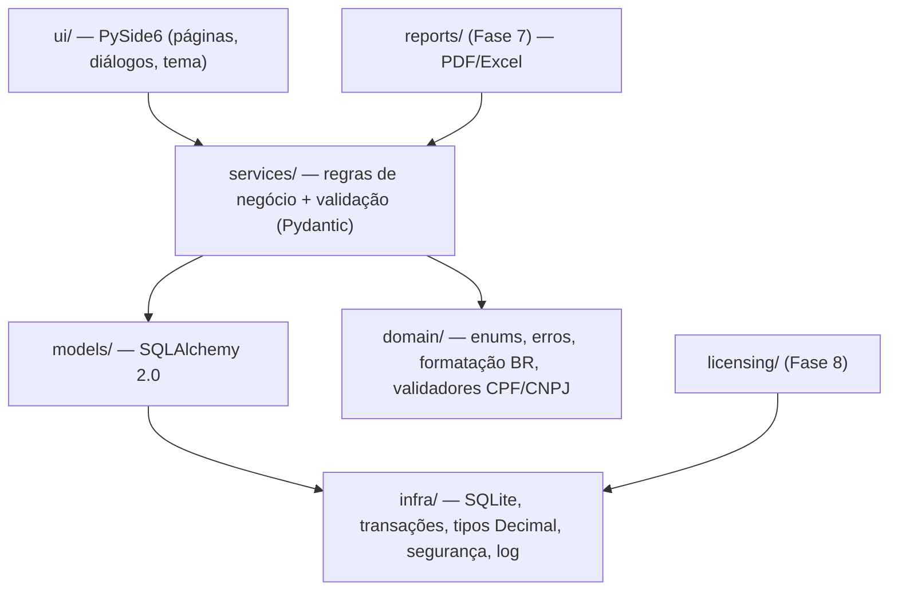
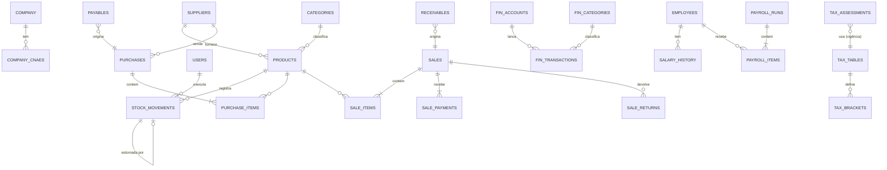

# StockPilot — Fase 1: Planejamento

> Documento vivo. Reflete as decisões tomadas até a Fase 2 (núcleo). Tabelas marcadas com 🟢 já existem no código;
> as demais são o desenho-alvo das fases seguintes.

## 1. Arquitetura

Aplicativo desktop **monolítico local** (um processo, um arquivo de banco), em camadas com dependência apenas "para dentro":



**Regras de camada.** A UI nunca fala com o banco: chama *services*. *Services* não importam Qt. Isso permite testar todas as regras
sem interface (a maior parte dos 52 testes) e trocar a UI no futuro.

**Decisões de arquitetura (e por quê)**

| Decisão | Motivo |
|---|---|
| SQLite em WAL, `synchronous=FULL`, `foreign_keys=ON` | Sem servidor, offline, durável contra queda de energia. |
| Transação por operação com `BEGIN IMMEDIATE` | Verificar saldo e gravar a movimentação acontece de forma atômica. Erro ⇒ *rollback* de tudo. |
| **Dinheiro/quantidade = inteiros escalados** (`ScaledDecimal`: custo ×10⁴, quantidade ×10³) expostos como `Decimal` | O `NUMERIC` do SQLite vira `float`. Inteiros mantêm soma/comparação exatas no SQL. Passar `float` levanta erro. |
| Livro-razão de estoque **imutável** (triggers `ABORT` em UPDATE/DELETE) | Correção só por estorno/ajuste; garantido pelo banco, não só pela UI. |
| Saldo em `products.quantity_on_hand` + `verify_consistency()` | Leitura rápida; auditoria compara com a soma das movimentações. |
| `idempotency_key` único nas movimentações | Base para impedir compra confirmada duas vezes (Fase 3). |
| Custo médio ponderado (CMP) | Metodologia da v1 (spec §9). Limitação documentada abaixo. |
| Datas em UTC no banco, local na tela | Evita erro de fuso/horário de verão. |
| `create_all` + tabela `settings.schema_version` agora; **Alembic antes do 1º release** | Sem clientes em produção ainda, migrações seriam peso morto. Banco de versão mais nova é recusado. |
| Senhas: `scrypt` (stdlib) | Sem dependência extra; nunca texto puro. |
| Usuário "admin" local sem senha até o login ser habilitado | Toda operação sensível já fica atribuída a um usuário identificado. |

**Limitação do CMP (a documentar para o cliente):** estornar uma *entrada* depois que o custo médio mudou **não recalcula** o custo
médio retroativamente; o estorno restitui apenas a quantidade. Venda a preço abaixo do custo e devoluções com custo diferente serão tratadas na Fase 3/4.

## 2. Estrutura de diretórios

```
stockpilot/
├─ pyproject.toml · requirements.txt · README.md
├─ docs/                      FASE1_PLANEJAMENTO.md · STATUS.md
├─ src/stockpilot/
│  ├─ __main__.py             ponto de entrada
│  ├─ app_context.py          bootstrap (pastas, log, banco, usuário padrão)
│  ├─ config/paths.py         %LOCALAPPDATA%\StockPilot\{data,logs,backups,config}
│  ├─ infra/                  database.py · types.py · security.py · logging_setup.py
│  ├─ domain/                 enums · errors · formatting · validators
│  ├─ models/                 base.py · entities.py
│  ├─ services/               schemas · company · product · stock · dashboard · settings · user
│  └─ ui/                     theme · common · main_window · pages/ · dialogs/
└─ tests/                     pytest (domínio + fluxos reais de UI em Qt offscreen)
```
Previstos: `services/{purchase,sales,finance,tax,payroll}`, `reports/`, `backup/`, `licensing/`, `installer/` (Inno Setup + PyInstaller).

## 3–4. Modelo de dados e relacionamentos



| Fase | Tabelas |
|---|---|
| 2 🟢 | `settings`, `users`, `company`, `company_cnaes`, `categories`, `suppliers`, `products`, `stock_movements` |
| 3 | `purchases`, `purchase_items`, `sales`, `sale_items`, `sale_payments`, `sale_returns`, `payment_methods` |
| 4 | `payables`, `receivables`, `fin_accounts`, `fin_categories`, `cost_centers`, `fin_transactions` |
| 5 | `tax_tables` (origem, vigência, data de atualização), `tax_brackets`, `revenue_entries`, `tax_assessments` (estimativa × oficial), `tax_obligations` |
| 6 | `employees`, `salary_history`, `dependents`, `payroll_tables` (INSS/IRRF/… com vigência), `payroll_runs`, `payroll_items` |
| 7–8 | `backup_log`, `license` |

**Convenções:** PK inteira; FKs `RESTRICT` (nada some em cascata, exceto CNAEs da empresa); valores monetários nunca `float`;
cancelamento = novo registro/estado, nunca `DELETE`; todo lançamento guarda usuário e `created_at`.

## 5. Plano de implementação

| Fase | Entrega | Situação |
|---|---|---|
| 1 | Este planejamento | ✅ |
| 2 | Empresa, banco, produtos, movimentação de estoque, painel | ✅ (ver STATUS.md) |
| 3 | Fornecedores, compras (idempotentes), PDV, pagamentos, estorno/devolução | ⏳ |
| 4 | Financeiro, CMV pelo custo médio, relatórios financeiros | ⏳ |
| 5 | Tributário — **só com tabelas oficiais verificadas** (MEI primeiro; Simples com anexos/faixas) | ⏳ |
| 6 | Funcionários/folha — idem; simulações rotuladas como estimativa | ⏳ |
| 7 | Relatórios PDF/Excel, backup/restauração, importação de planilha | ⏳ |
| 8 | Licenciamento, instalador (PyInstaller + Inno Setup), documentação, testes finais em Windows | ⏳ |

## 6. Riscos e mitigação

| Risco | Impacto | Mitigação |
|---|---|---|
| Tabelas/regras tributárias e trabalhistas mudam (ex.: reforma tributária) | Cálculo errado vira passivo para o cliente | Tabelas em dados (não em código), com origem + vigência + data de atualização; resultado sempre rotulado *estimativa*; testes só com casos tirados de fontes oficiais; módulo só "completo" quando validado por contador |
| Perda/corrupção do banco do cliente | Perda do negócio | WAL + `synchronous=FULL`, `integrity_check` na abertura, backup automático + verificação (Fase 7), restauração que não sobrescreve sem confirmação |
| Estoque inconsistente | Decisões erradas | Ledger imutável, transação por operação, `verify_consistency()`, idempotência |
| Erro de arredondamento financeiro | Divergência de centavos | Sem `float`; inteiros escalados; regra de arredondamento única (half-even no armazenamento) |
| Promessa fiscal indevida (NFC-e/NF-e, eSocial) | Risco legal/comercial | Fora do escopo do núcleo; UI não afirma emissão oficial; integração fiscal é projeto à parte (certificado A1, SEFAZ/UF, homologação) |
| Licenciamento sem servidor | Venda sem proteção, ou bloqueio indevido | Interface provisória identificada; **nunca bloquear acesso aos dados**; ativação offline por chave assinada é a opção mais simples; servidor só quando existir |
| Antivírus acusa executável PyInstaller | Fricção na venda | Assinatura de código (certificado), instalador Inno Setup, testes em Windows limpo |
| Desenvolvido/testado em Linux | Bugs só no Windows | Caminhos via `pathlib`/`platformdirs`; **testar em Windows 10/11 antes de qualquer venda** (pendente) |
| LGPD (dados de funcionários e clientes) | Multa/vazamento | Perfis de acesso, senha com scrypt, política de retenção documentada (Fase 6/8) |
| CNPJ alfanumérico (desde jul/2026) | Rejeitar empresas novas | Validador já implementado (ASCII−48, módulo 11) com o vetor oficial da Receita; coluna `String(14)` |

## 7. Dependências e ambiente

Python ≥ 3.11 · PySide6 ≥ 6.6 · SQLAlchemy ≥ 2.0 · Pydantic ≥ 2.5 · platformdirs · openpyxl · pytest.
Previstas: reportlab (PDF, Fase 7), Alembic (antes do release), PyInstaller + Inno Setup (Fase 8).
Alvo: Windows 10/11 64 bits, sem internet para as operações principais. Nenhuma dependência de IA no produto.

## 8. Critérios de aceitação do MVP (núcleo comercial)

1. Instala e abre em Windows 10/11 limpo, sem Python instalado; dados em `%LOCALAPPDATA%` preservados em atualização. *(Fase 8)*
2. Cadastrar empresa (CNPJ validado) e produtos; buscar por nome/SKU/barras. ✅
3. Todo movimento de estoque deixa histórico imutável com data, quantidade, motivo, origem e usuário; estoque negativo bloqueado. ✅
4. Compra confirmada atualiza estoque **uma única vez**. *(Fase 3)*
5. Venda grava venda+itens+pagamento+baixa de estoque numa transação; cancelamento reverte. *(Fase 3)*
6. Painel só com números reais; vazio ⇒ zeros e orientação. ✅ (indicadores de Compras/Vendas/Financeiro chegam com seus módulos)
7. Backup manual/automático e restauração verificada. *(Fase 7)*
8. Nenhum `float` em valores monetários; testes automatizados passando. ✅ (núcleo)
9. Estimativas fiscais/folha sempre rotuladas como estimativa. *(Fases 5–6)*
10. Testado manualmente em Windows por pessoa real (loja piloto) antes da comercialização. *(pendente)*

## Decisões que preciso confirmar com você (impactam o escopo comercial)

1. **Licenciamento:** aceita chave de licença assinada e validada **offline** (sem servidor) na v1.0? É a opção mais simples; transferência de PC seria por emissão manual de nova chave.
2. **Perfis/login:** manter login desligado por padrão (loja de uma pessoa) com opção de ativar?
3. **Fiscal:** confirmar que NFC-e/NF-e ficam **fora** da v1.0 (venda com "comprovante interno não fiscal").
