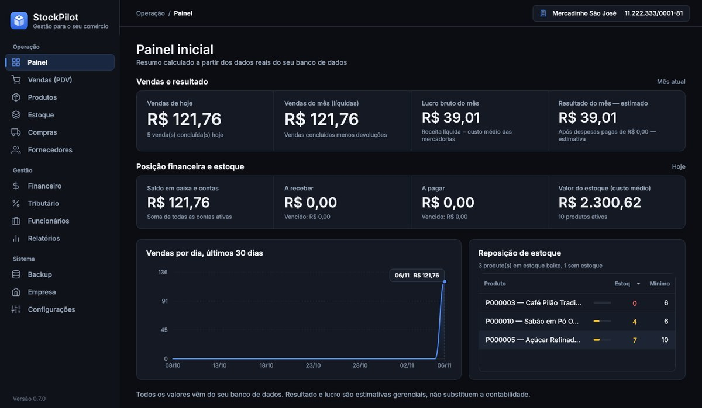
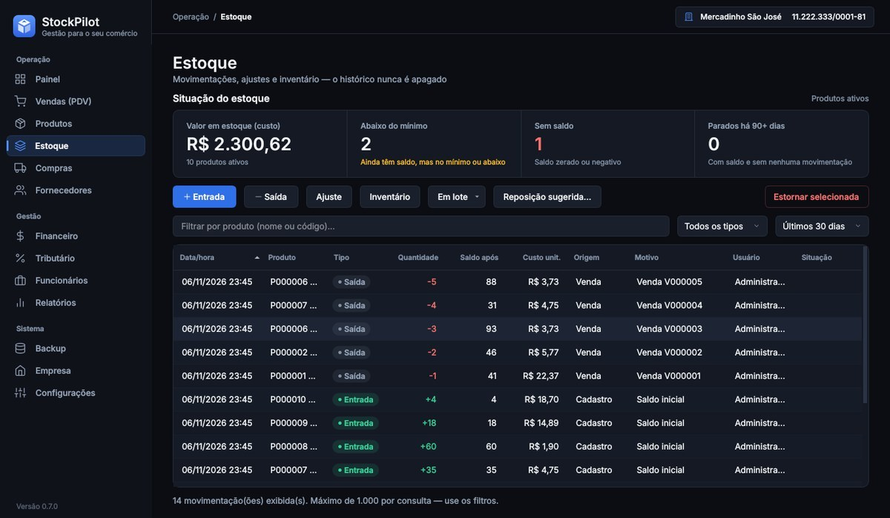
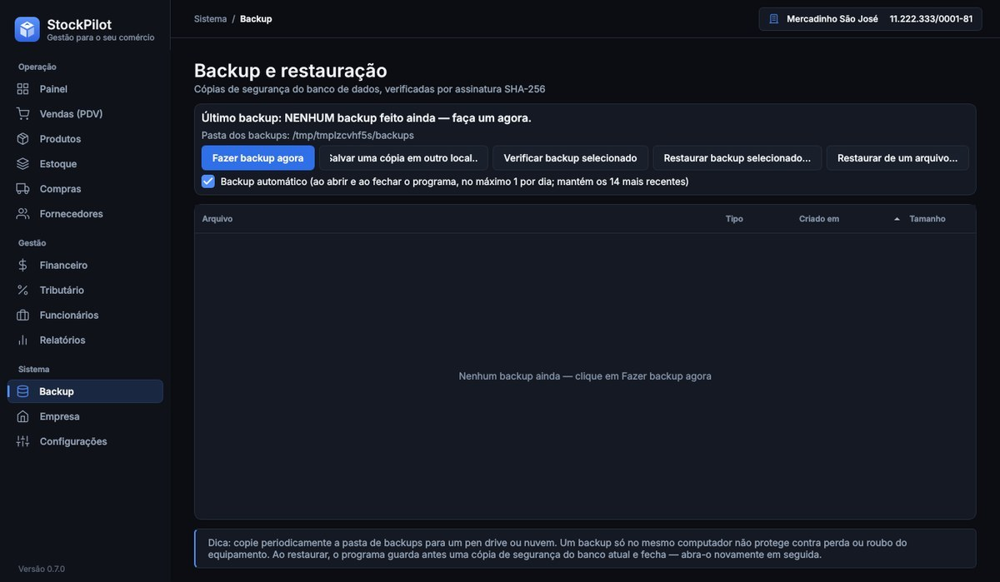

# Manual do StockPilot

Versão 0.7.1 · para Windows 10 e 11 de 64 bits

## Antes de começar

O StockPilot organiza **estoque, vendas internas, compras, contas e relatórios** do seu comércio. Ele funciona **sem internet** e guarda tudo no seu computador.

Três avisos importantes:

- **Não emite nota fiscal.** O comprovante da venda é interno, sem valor fiscal. Se você precisa emitir NFC-e ou NF-e, continue usando o seu emissor.
- **Impostos e folha são estimativas** de apoio à gestão. Confirme sempre com o seu contador.
- **Backup é com você.** Os dados ficam só neste computador. Veja a seção "Backup e seus dados".

## 1. Instalação

1. Baixe o instalador `StockPilot-Setup-<versão>.exe` pelo link que você recebeu.
2. Dê dois cliques no arquivo e siga as telas. A instalação leva cerca de um minuto.
3. Ao final, marque "Abrir o StockPilot agora" ou use o atalho da Área de Trabalho.

**Se o Windows mostrar "O Windows protegeu seu computador":** isso acontece com programas novos ou sem assinatura digital reconhecida. Clique em **Mais informações** e depois em **Executar assim mesmo**.

**Se o arquivo for bloqueado ou não abrir:** clique com o botão direito no instalador, escolha **Propriedades**, marque **Desbloquear** na parte de baixo e clique em OK. Depois abra de novo. Se o seu Windows tiver o *Controle de Aplicativo Inteligente* ligado, ele pode bloquear programas novos; nesse caso fale com o suporte.

**Atualizar:** instale a versão nova por cima da antiga. Seus dados não são apagados.

**Desinstalar:** pelo painel do Windows. Seus dados e backups ficam guardados em `%LOCALAPPDATA%\StockPilot` e só saem de lá se você apagar a pasta.

## 2. Primeiros passos

1. **Empresa** — cadastre razão social, CNPJ, regime (MEI/Simples) e data de início da atividade (necessária para as estimativas).
2. **Produtos** — cadastre um a um ou **Importar planilha** (baixe o modelo). Estoque inicial vira uma entrada no histórico.
3. **Fornecedores → Compras** — crie a compra (rascunho), confira e **confirme**: só então o estoque sobe e o financeiro é lançado (uma única vez). Compra a prazo gera *contas a pagar*.
4. **Vendas (PDV)** — leia o código de barras ou busque pelo nome, ajuste quantidade/desconto, **F2** para finalizar, escolha as formas de pagamento (pode misturar). Desconto acima do limite exige gerente/admin. O comprovante é **interno, sem valor fiscal**. Em *Histórico*: reimprimir comprovante, devolução, cancelamento (estorna estoque e caixa).
5. **Financeiro** — resumo (resultado **estimado**), contas a pagar/receber (dar baixa, estornar baixa), fluxo de caixa, lançamentos manuais, contas e categorias.
6. **Tributário** — informe o faturamento dos meses sem vendas no sistema, escolha a competência e *Calcular estimativa*. Leia os avisos e os **dados que faltam**. Confirme sempre com o PGDAS-D/PGMEI e o contador.
7. **Funcionários** — cadastro, benefícios, folha do mês estimada, simulações de 13º/férias/rescisão. Dados sensíveis: só Admin/Gerente.
8. **Relatórios** — 16 relatórios com filtros; exporte em Excel ou PDF.
9. **Backup** — faça backup manual, mantenha o automático ligado e **copie a pasta de backups para um pen drive/nuvem**. Restaurar substitui os dados atuais (guarda cópia de segurança antes).
10. **Configurações** (Admin) — desconto máximo, estoque negativo, RAT/terceiros, usuários e login.

## Leitor de código de barras

O StockPilot funciona com leitores USB comuns que "digitam" o código como um teclado (modo HID). Não é preciso instalar nada: basta conectar o leitor. A maioria já vem de fábrica enviando **Enter** no final da leitura, que é o padrão recomendado. O envio de **Tab** no final também é aceito.

- **Produtos**:
  - Leia o produto com o foco em qualquer ponto da tela.
  - Se ele existir, a linha fica selecionada e aparece "Produto encontrado", com o estoque atual. Use **Entrada** ou **Editar** para atualizar.
  - Se não existir, aparece "Código … não cadastrado" e o botão **Cadastrar com este código**, que abre o cadastro já preenchido.
- **Cadastro de produto**:
  - A leitura preenche o campo Código de barras mesmo que o cursor esteja em outro campo.
  - O Enter do leitor **não salva** o cadastro.
  - O sistema avisa na hora se o código já pertence a outro produto, porque um código não pode se repetir.
  - Produtos sem código de barras continuam podendo ser cadastrados.
- **Vendas (PDV)**:
  - Leituras seguidas somam a quantidade no carrinho.
  - Um código não cadastrado mostra um aviso e **não** adiciona um produto parecido.
- **Compras**: a leitura escolhe o produto da linha da compra.
- **Estoque**:
  - A leitura filtra o histórico daquele produto.
  - Em seguida, Entrada, Saída, Ajuste e Inventário já abrem com o produto escolhido.
- **Entrada, saída e ajuste**: a leitura escolhe o produto e leva o cursor direto para a quantidade.

Como o sistema distingue o leitor da digitação: o leitor envia as teclas com poucos milissegundos de intervalo, enquanto uma pessoa digita muito mais devagar. Se o seu leitor não envia Enter nem Tab no final, configure-o pelo manual do aparelho, normalmente lendo um código de configuração ("Add CR suffix").

## Gestão de estoque

- **Situação do estoque** (topo da tela Estoque): valor em estoque a custo, produtos abaixo do mínimo, sem saldo e parados há 90+ dias.
- **Em lote** (Entrada, Saída ou Inventário): leia os códigos com o leitor (cada leitura soma 1) ou busque pelo nome, ajuste as quantidades na tabela e lance tudo de uma vez. Se algum item der erro, nada é gravado. Reenviar o mesmo lote não duplica.
- **Reposição sugerida**: lista o que comprar e quanto, com o motivo (sem saldo, abaixo do mínimo ou pouca cobertura). Os critérios aparecem na própria tela. Dá para editar as quantidades, exportar para Excel ou dar entrada direto. É uma sugestão: confira antes de comprar.
- **Proteção contra repetição**: lançar entrada/saída idêntica logo após outra pede confirmação; o clique duplo no botão não grava duas vezes.
- **Produtos**: a lista mostra até 500 linhas (com aviso do total); use a busca, o leitor ou os filtros "Estoque baixo" e "Sem saldo" para achar o restante.
- **Relatórios → Giro e reposição de estoque**: saídas, média diária e cobertura por produto no período.

## Backup e seus dados

- Os dados ficam em `%LOCALAPPDATA%\StockPilot`. Para abrir: aperte as teclas Windows + R, cole `%LOCALAPPDATA%\StockPilot` e tecle Enter.
  - `data`: o banco de dados com tudo o que você cadastrou.
  - `backups`: as cópias de segurança.
  - `logs`: o registro de funcionamento do programa.
- Na tela **Backup**, faça um backup manual de vez em quando e mantenha o automático ligado.
- **Copie a pasta `backups` para um pen drive ou para a nuvem.** Se o computador estragar, só a cópia fora dele salva você.
- **Trocar de computador:** faça o backup, instale o StockPilot no computador novo e restaure o backup pela tela Backup.
- Restaurar um backup **substitui os dados atuais**. O programa guarda uma cópia de segurança antes.

## Problemas comuns

| Situação | O que fazer |
| --- | --- |
| O leitor de código de barras não preenche o campo | Abra o Bloco de Notas e leia um código. Se aparecerem números, o leitor funciona e o problema é o foco da tela. Se não aparecerem, veja o manual do leitor (modo teclado/HID). |
| O saldo parece errado | Abra Estoque e veja o histórico do produto. Cada entrada, saída, venda e ajuste aparece lá, com data e usuário. |
| Lancei algo errado | Movimentações não são apagadas. Use **Estornar selecionada** (Estoque) ou a devolução/cancelamento da venda. |
| O programa fechou sozinho | Abra de novo. Seus dados são gravados a cada operação. Se se repetir, envie o arquivo de log ao suporte. |

## Suporte

Escreva para **entrepaines@gmail.com** com o e-mail usado na compra. Descreva o que você estava fazendo e o que apareceu na tela, e anexe uma foto da tela.

Se o problema for um erro do programa, anexe também o arquivo `stockpilot.log` da pasta `logs` (veja "Backup e seus dados"). Ele registra o funcionamento do programa e **pode conter nomes de produtos e caminhos de pastas**; envie só se estiver de acordo.

O suporte por e-mail vale por 90 dias após a compra, com resposta em até 2 dias úteis. Este manual, os vídeos e as perguntas frequentes continuam disponíveis depois disso.
